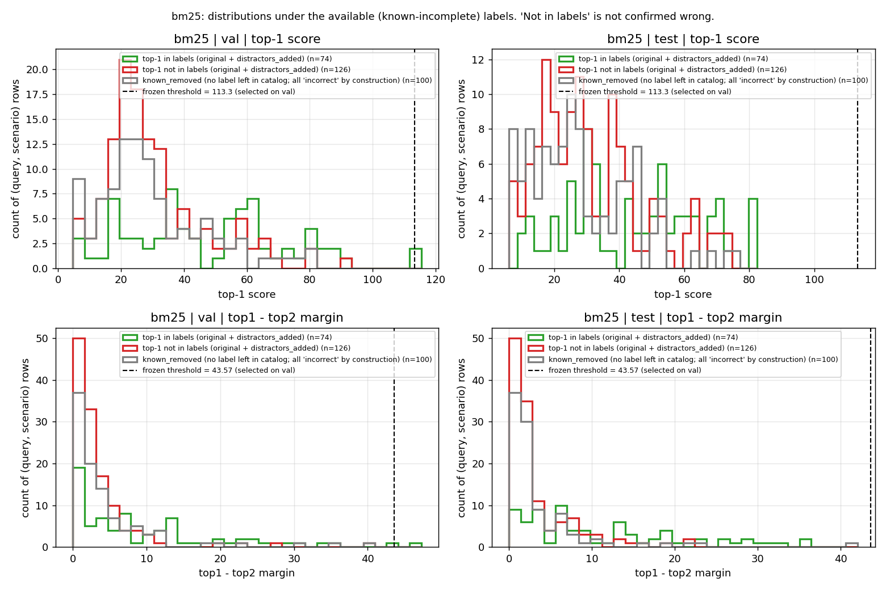
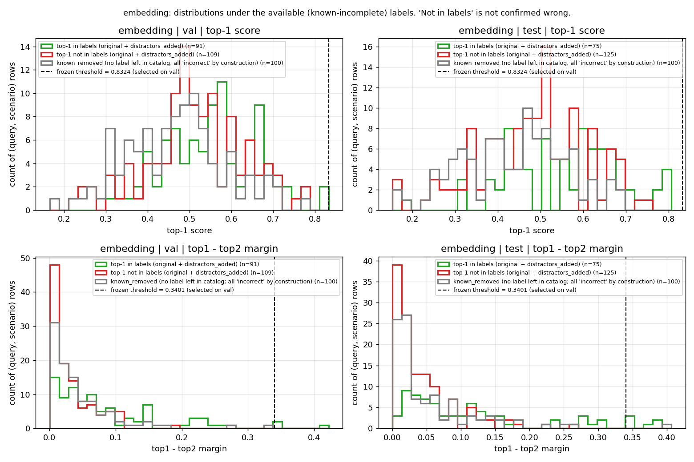
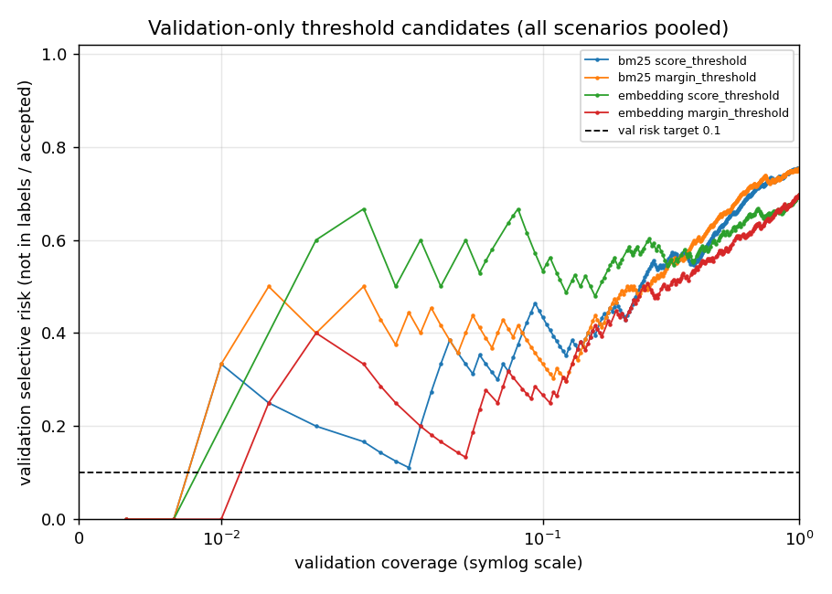

# Milestone 2: evaluation audit and abstention-failure diagnosis

Status: **diagnostic only**. No new model was trained, no threshold or
method was changed or re-selected on test results, and no item was
marked human-reviewed. Every number below is recomputed from the
milestone-1 pilot artifacts in `results/toolret_pilot/` (git commit
`9ce515d`), which were read-only during the audit (all 10 files
SHA-256-verified before and after; hashes are in
`results/evaluation_audit/reproducibility.json`).

Reproduce:

```bash
export DYLD_LIBRARY_PATH=/opt/homebrew/opt/expat/lib   # macOS note, see AGENTS.md
python scripts/audit_evaluation.py --config configs/pilot_toolret.yaml \
    --pilot-dir results/toolret_pilot --out-dir results/evaluation_audit
```

This runs in a few seconds and does not load the embedding model.

## How to read this document

* **"Correct"/"accuracy" means agreement with the known relevance
  labels.** ToolRet labels are an incomplete set of positives. A top-1
  tool outside the labels is *unlabeled*, not shown to be wrong.
  "Selective risk" is therefore "fraction of accepted selections outside
  the annotated labels".
* **`known_removed` is a controlled label-removal experiment.** It is not
  an unanswerable set. Every top-1 there is "incorrect" by construction,
  because no labeled tool is left in the catalog. Unlabeled valid tools
  may remain.
* **True unanswerability metrics are unavailable.** False-action rate and
  abstention-on-answerable need audited answerable/unanswerable items.
  None exist yet (see section 5).
* **The pilot test split is now exploratory.** Its results shaped this
  audit. Treat it as a development set from here on. A fresh confirmatory
  pool is reserved (section 6).
* Intervals: Wilson 95% intervals for single proportions. Paired
  differences use a query-grouped bootstrap (2,000 resamples). Every rate
  is shown as numerator/denominator. "undef" means the denominator is 0.

## 0. Reconciling "43–48%" vs. "43–52%"

| method | dev (original) | val (original) | test (original) |
|---|---|---|---|
| BM25 | 136/300 = 45.3% | 47/100 = 47.0% | **48/100 = 48.0%** [38.5%, 57.7%] |
| embedding | 154/300 = 51.3% | 54/100 = 54.0% | **43/100 = 43.0%** [33.7%, 52.8%] |

(Top-1 agreement with labels under `always_top1`. Test intervals are
Wilson 95%.)

`results/toolret_pilot/REPORT.md` and `metrics.json` report test values of
0.48 and 0.43, so **the correct test range is 43–48%**. No measured
accuracy on any split is 52%. The number that is exactly 52% is BM25's
test **selective risk** (52/100 = 1 − 0.48). The README's "~43–52%" most
likely came from mixing up that risk with accuracy. The README is now
corrected. Across all three splits the range is 43–54%. The test
intervals overlap heavily: on test, BM25 − embedding = +0.05, 95% CI
[−0.05, +0.14], with 15 vs. 10 discordant queries. **The two baselines
are not distinguishable on this sample.**

## 1. Dataset eligibility (single-tool vs. multi-tool)

The single-tool classification is still a **subset-level heuristic**
(`data/toolret_constants.py`). It has not been checked query by query.
Label counts per request in the five pilot subsets:

| subset | 1 label | 2+ labels |
|---|---|---|
| apibank | 48 | 53 |
| apigen | 712 | 288 |
| gorilla-huggingface | 500 | 0 |
| metatool | 179 | 21 |
| toolalpaca | 94 | 0 |

So 362 of the 1,895 requests (19%) carry more than one label. The pilot
metric treats any labeled tool as correct, which **implicitly assumes
multiple labels are alternatives**. That assumption has not been checked.
Visible apigen requests often join two separate tasks, for example "get
the SEO summary for … *and* generate a QR code for …". If such labels are
jointly required, a single top-1 cannot fully satisfy the request, and
"correct" overstates success. This is an observation about request
wording, not a judgment. Judgments are left to the review sheet.

**Human-review sheet:**
`results/evaluation_audit/review/single_multi_tool_review_sample.csv`
(plus a long-format companion with full tool docs). It has 100 requests:
20 per subset, a fixed seed, and draws from all 1,895 requests (75 are
outside the pilot; 14 are dev, 4 val, 7 test). Multi-label requests are
oversampled; `sampling_weight` corrects for this. Columns: query text,
every annotated tool with name and description, source subset/category,
upstream ID, and **blank** fields for request type, label relation
(alternatives / jointly required / mixed / …), label completeness,
reviewer, notes, and `human_reviewed`. Instructions:
`docs/review_workflow.md` §A.

| stratum | population | sampled |
|---|---|---|
| apibank|1_label | 48 | 10 |
| apibank|2plus_labels | 53 | 10 |
| apigen|1_label | 712 | 10 |
| apigen|2plus_labels | 288 | 10 |
| gorilla-huggingface|1_label | 500 | 20 |
| metatool|1_label | 179 | 10 |
| metatool|2plus_labels | 21 | 10 |
| toolalpaca|1_label | 94 | 20 |

## 2. Catalog construction

### Invariant checks (all 500 pilot queries, 1,500 catalogs)

| check | checked | violations |
|---|---|---|
| all_three_scenarios_present | 500 | 0 |
| original_contains_every_annotated_tool | 500 | 0 |
| known_removed_equals_original_minus_annotated | 500 | 0 |
| known_removed_contains_no_annotated_tool | 500 | 0 |
| distractors_not_in_original_by_id | 500 | 0 |
| distractors_from_held_out_pool | 500 | 0 |
| distractors_resolve_to_known_tools | 500 | 0 |
| distractors_unique_within_catalog | 500 | 0 |
| distractors_added_equals_original_plus_distractors | 500 | 0 |
| distractors_content_distinct_from_original | 500 | 0 |
| distractors_not_annotated_valid | 500 | 0 |
| catalog_tool_ids_unique | 1500 | 0 |

Coverage of each check:

* **Original catalogs contain every annotated tool.** Holds for 500/500.
  No pilot label is missing from the downloaded corpus (0 queries).
  Note that the generator itself does *not* enforce this.
  `build_catalog_scenarios` quietly accepts labels missing from the pool
  (see `tests/test_catalog.py::test_known_removed_handles_valid_tool_not_in_pool`).
  It holds here only because the pool is built from the families of the
  labeled tools.
* **`known_removed` removes every annotated tool.** It equals original
  minus labels for 500/500, and no labeled tool is left in any of them.
* **Distractors are new, distinct entries.** All 1,500 added tools (3 per
  catalog) are absent from the original catalog by ID and come from the
  held-out pool (families outside the pilot). Each resolves to a real
  tool, none repeats within a catalog, and none duplicates the content of
  an original tool after whitespace/case normalization. That last check
  only catches *exact* duplicates. Distractors can still be functionally
  equivalent to a valid tool, which is the next point.
* **Added tools are not assumed irrelevant by construction, but the
  metric does treat them as errors.** On test, **all 22 (BM25) and 11
  (embedding) queries that flip from correct in `original` to incorrect in
  `distractors_added` flip because an added distractor became top-1.**
  The same holds on val (20/20 and 17/17). Overall, a distractor is top-1
  in 64/100 (BM25) and 31/100 (embedding) test catalogs. Several such
  distractors look plausibly valid when read. For example,
  `rotbench/get_today_date` ("Get today's date.") is top-1 for "Can you
  tell me today's date?". `ultraTool/change_account_password` is top-1
  for "Can you help me change my password?". **So the reported
  `distractors_added` accuracy drop (BM25 −22 points, embedding −11
  points on test) is an upper bound on real degradation, not a measured
  degradation.** All 168 (val+test query, distractor) top-1 cases are in
  `review/distractor_top1_review.csv` for human judgment (§B in the
  review workflow).
* **Distractors were chosen by BM25 lexical similarity to the query.**
  That favors BM25 picking them (64 vs. 31 top-1 picks), so the BM25 vs.
  embedding comparison under `distractors_added` is confounded by how
  the scenario was built.
* **Catalogs and query sets are identical across methods.** Both methods
  have the same 1,500 (query, scenario, catalog_id) triples, and all
  3,000 returned top-k lists lie inside their manifest's catalog. By code
  design, `evaluation/pipeline.py` builds one tool list per manifest and
  passes that same list to every retriever.

### Catalog sizes

| subset | scenario | n | min | median | mean | max |
|---|---|---|---|---|---|---|
| apibank | distractors_added | 28 | 104 | 104.0 | 104.0 | 104 |
| apibank | known_removed | 28 | 97 | 99.0 | 99.32 | 100 |
| apibank | original | 28 | 101 | 101.0 | 101.0 | 101 |
| apigen | distractors_added | 270 | 3608 | 3608.0 | 3608.0 | 3608 |
| apigen | known_removed | 270 | 3601 | 3604.0 | 3603.64 | 3604 |
| apigen | original | 270 | 3605 | 3605.0 | 3605.0 | 3605 |
| gorilla-huggingface | distractors_added | 128 | 910 | 910.0 | 910.0 | 910 |
| gorilla-huggingface | known_removed | 128 | 906 | 906.0 | 906.0 | 906 |
| gorilla-huggingface | original | 128 | 907 | 907.0 | 907.0 | 907 |
| metatool | distractors_added | 48 | 203 | 203.0 | 203.0 | 203 |
| metatool | known_removed | 48 | 198 | 199.0 | 198.9 | 199 |
| metatool | original | 48 | 200 | 200.0 | 200.0 | 200 |
| toolalpaca | distractors_added | 26 | 1940 | 1940.0 | 1940.0 | 1940 |
| toolalpaca | known_removed | 26 | 1936 | 1936.0 | 1936.0 | 1936 |
| toolalpaca | original | 26 | 1937 | 1937.0 | 1937.0 | 1937 |
| ALL | original | 500 | 101 | 3605.0 | 2304.47 | 3605 |
| ALL | known_removed | 500 | 97 | 3603.0 | 2303.23 | 3604 |
| ALL | distractors_added | 500 | 104 | 3608.0 | 2307.47 | 3608 |

The `original` catalog is the query's whole source-subset tool family, so
every query in a subset shares one catalog. Sizes vary by 36× across
subsets (101 for apibank, 3,605 for apigen). Pooled metrics are
therefore dominated by apigen (270 of 500 pilot queries; 48 of 100 test
queries). On test, per-subset original agreement for BM25 / embedding:
apigen 30/48 and 29/48, gorilla-huggingface 6/27 and 3/27, apibank 5/8
and 4/8, metatool 4/11 and 6/11, toolalpaca 3/6 and 1/6. Only apigen is
large enough for a subset-level statement.

### Does scenario construction use relevance labels? What it limits

Yes, in two places. (a) The `original` pool is the set of tool families
that the subset's *labels* point to. (b) `known_removed` is defined
entirely as "original minus labels". Only `distractors_added` ignores
labels; it uses BM25 over held-out families. Consequences:

1. `known_removed` simulates "the labeled tool disappeared". It does not
   simulate "no suitable tool exists". A deployed router would never see
   a catalog shaped by its own test labels. Since labels are incomplete,
   some `known_removed` catalogs remain answerable, and an abstention
   method is penalised for correctly picking an unlabeled valid tool.
2. The catalogs are single-family, reduced catalogs with 101–3,608
   tools. They are not ToolRet's official corpora (3.4k–37k tools mixed
   across sources), and they are not a real deployment catalog
   (dozens of heterogeneous tools that change over time).
3. Distractors are lexically similar tools from other benchmarks. They
   are not real tool additions, and as shown above many may be valid.

So the scenarios support **controlled statements about agreement with
labels when labeled tools are removed or lexically similar tools are
added**. They do not support statements about deployment reliability
when tools change.

## 3. Threshold selection diagnosis

### Scope and objective

* **Thresholds are global per method, not per scenario.** For each method
  and policy, one threshold was chosen on **validation**, pooling all
  three scenarios (300 rows = 100 queries × 3). It was then frozen and
  applied to every scenario on test (`cli.py::_run_pipeline`). This
  single frozen policy across mixed scenarios is the deployment-realistic
  setting. The "ALL (mixed)" rows below report it. The per-scenario
  rows apply the same policy; they are breakdowns, not separate policies.
* **Objective:** maximize validation coverage subject to *empirical*
  validation selective risk ≤ 0.10. Candidates are −∞ plus every distinct
  validation score (or margin). A row is accepted iff its signal ≥ t. If
  no candidate meets the target, the minimum-risk candidate is used
  (this fallback was never triggered).
* **A 10% empirical validation-risk target does not guarantee 10% test
  risk.** It is a point estimate on very few accepted validation rows (see
  below). The procedure gives no finite-sample guarantee.

### Exact counts: frozen global policy, test split

| method | policy | threshold | scenario | n | accepted | correct | incorrect | coverage [95% Wilson] | selective risk [95% Wilson] |
|---|---|---|---|---|---|---|---|---|---|
| bm25 | always_top1 | n/a | distractors_added | 100 | 100 | 26 | 74 | 100/100 = 1.000 [0.963, 1.000] | 74/100 = 0.740 [0.646, 0.816] |
| bm25 | always_top1 | n/a | known_removed | 100 | 100 | 0 | 100 | 100/100 = 1.000 [0.963, 1.000] | 100/100 = 1.000 [0.963, 1.000] |
| bm25 | always_top1 | n/a | original | 100 | 100 | 48 | 52 | 100/100 = 1.000 [0.963, 1.000] | 52/100 = 0.520 [0.423, 0.615] |
| bm25 | always_top1 | n/a | ALL (mixed) | 300 | 300 | 74 | 226 | 300/300 = 1.000 [0.987, 1.000] | 226/300 = 0.753 [0.702, 0.799] |
| bm25 | score_threshold | 113.3 | distractors_added | 100 | 0 | 0 | 0 | 0/100 = 0.000 [0.000, 0.037] | 0/0 = undef undef |
| bm25 | score_threshold | 113.3 | known_removed | 100 | 0 | 0 | 0 | 0/100 = 0.000 [0.000, 0.037] | 0/0 = undef undef |
| bm25 | score_threshold | 113.3 | original | 100 | 0 | 0 | 0 | 0/100 = 0.000 [0.000, 0.037] | 0/0 = undef undef |
| bm25 | score_threshold | 113.3 | ALL (mixed) | 300 | 0 | 0 | 0 | 0/300 = 0.000 [0.000, 0.013] | 0/0 = undef undef |
| bm25 | margin_threshold | 43.57 | distractors_added | 100 | 0 | 0 | 0 | 0/100 = 0.000 [0.000, 0.037] | 0/0 = undef undef |
| bm25 | margin_threshold | 43.57 | known_removed | 100 | 0 | 0 | 0 | 0/100 = 0.000 [0.000, 0.037] | 0/0 = undef undef |
| bm25 | margin_threshold | 43.57 | original | 100 | 0 | 0 | 0 | 0/100 = 0.000 [0.000, 0.037] | 0/0 = undef undef |
| bm25 | margin_threshold | 43.57 | ALL (mixed) | 300 | 0 | 0 | 0 | 0/300 = 0.000 [0.000, 0.013] | 0/0 = undef undef |
| embedding | always_top1 | n/a | distractors_added | 100 | 100 | 32 | 68 | 100/100 = 1.000 [0.963, 1.000] | 68/100 = 0.680 [0.583, 0.763] |
| embedding | always_top1 | n/a | known_removed | 100 | 100 | 0 | 100 | 100/100 = 1.000 [0.963, 1.000] | 100/100 = 1.000 [0.963, 1.000] |
| embedding | always_top1 | n/a | original | 100 | 100 | 43 | 57 | 100/100 = 1.000 [0.963, 1.000] | 57/100 = 0.570 [0.472, 0.663] |
| embedding | always_top1 | n/a | ALL (mixed) | 300 | 300 | 75 | 225 | 300/300 = 1.000 [0.987, 1.000] | 225/300 = 0.750 [0.698, 0.796] |
| embedding | score_threshold | 0.8324 | distractors_added | 100 | 0 | 0 | 0 | 0/100 = 0.000 [0.000, 0.037] | 0/0 = undef undef |
| embedding | score_threshold | 0.8324 | known_removed | 100 | 0 | 0 | 0 | 0/100 = 0.000 [0.000, 0.037] | 0/0 = undef undef |
| embedding | score_threshold | 0.8324 | original | 100 | 0 | 0 | 0 | 0/100 = 0.000 [0.000, 0.037] | 0/0 = undef undef |
| embedding | score_threshold | 0.8324 | ALL (mixed) | 300 | 0 | 0 | 0 | 0/300 = 0.000 [0.000, 0.013] | 0/0 = undef undef |
| embedding | margin_threshold | 0.3401 | distractors_added | 100 | 2 | 2 | 0 | 2/100 = 0.020 [0.006, 0.070] | 0/2 = 0.000 [0.000, 0.658] |
| embedding | margin_threshold | 0.3401 | known_removed | 100 | 1 | 0 | 1 | 1/100 = 0.010 [0.002, 0.054] | 1/1 = 1.000 [0.207, 1.000] |
| embedding | margin_threshold | 0.3401 | original | 100 | 4 | 4 | 0 | 4/100 = 0.040 [0.016, 0.098] | 0/4 = 0.000 [0.000, 0.490] |
| embedding | margin_threshold | 0.3401 | ALL (mixed) | 300 | 7 | 6 | 1 | 7/300 = 0.023 [0.011, 0.047] | 1/7 = 0.143 [0.026, 0.513] |

### Exact counts: frozen global policy, validation split

| method | policy | threshold | scenario | n | accepted | correct | incorrect | coverage [95% Wilson] | selective risk [95% Wilson] |
|---|---|---|---|---|---|---|---|---|---|
| bm25 | always_top1 | n/a | distractors_added | 100 | 100 | 27 | 73 | 100/100 = 1.000 [0.963, 1.000] | 73/100 = 0.730 [0.636, 0.807] |
| bm25 | always_top1 | n/a | known_removed | 100 | 100 | 0 | 100 | 100/100 = 1.000 [0.963, 1.000] | 100/100 = 1.000 [0.963, 1.000] |
| bm25 | always_top1 | n/a | original | 100 | 100 | 47 | 53 | 100/100 = 1.000 [0.963, 1.000] | 53/100 = 0.530 [0.433, 0.625] |
| bm25 | always_top1 | n/a | ALL (mixed) | 300 | 300 | 74 | 226 | 300/300 = 1.000 [0.987, 1.000] | 226/300 = 0.753 [0.702, 0.799] |
| bm25 | score_threshold | 113.3 | distractors_added | 100 | 1 | 1 | 0 | 1/100 = 0.010 [0.002, 0.054] | 0/1 = 0.000 [0.000, 0.793] |
| bm25 | score_threshold | 113.3 | known_removed | 100 | 0 | 0 | 0 | 0/100 = 0.000 [0.000, 0.037] | 0/0 = undef undef |
| bm25 | score_threshold | 113.3 | original | 100 | 1 | 1 | 0 | 1/100 = 0.010 [0.002, 0.054] | 0/1 = 0.000 [0.000, 0.793] |
| bm25 | score_threshold | 113.3 | ALL (mixed) | 300 | 2 | 2 | 0 | 2/300 = 0.007 [0.002, 0.024] | 0/2 = 0.000 [0.000, 0.658] |
| bm25 | margin_threshold | 43.57 | distractors_added | 100 | 0 | 0 | 0 | 0/100 = 0.000 [0.000, 0.037] | 0/0 = undef undef |
| bm25 | margin_threshold | 43.57 | known_removed | 100 | 0 | 0 | 0 | 0/100 = 0.000 [0.000, 0.037] | 0/0 = undef undef |
| bm25 | margin_threshold | 43.57 | original | 100 | 2 | 2 | 0 | 2/100 = 0.020 [0.006, 0.070] | 0/2 = 0.000 [0.000, 0.658] |
| bm25 | margin_threshold | 43.57 | ALL (mixed) | 300 | 2 | 2 | 0 | 2/300 = 0.007 [0.002, 0.024] | 0/2 = 0.000 [0.000, 0.658] |
| embedding | always_top1 | n/a | distractors_added | 100 | 100 | 37 | 63 | 100/100 = 1.000 [0.963, 1.000] | 63/100 = 0.630 [0.532, 0.718] |
| embedding | always_top1 | n/a | known_removed | 100 | 100 | 0 | 100 | 100/100 = 1.000 [0.963, 1.000] | 100/100 = 1.000 [0.963, 1.000] |
| embedding | always_top1 | n/a | original | 100 | 100 | 54 | 46 | 100/100 = 1.000 [0.963, 1.000] | 46/100 = 0.460 [0.366, 0.557] |
| embedding | always_top1 | n/a | ALL (mixed) | 300 | 300 | 91 | 209 | 300/300 = 1.000 [0.987, 1.000] | 209/300 = 0.697 [0.642, 0.746] |
| embedding | score_threshold | 0.8324 | distractors_added | 100 | 1 | 1 | 0 | 1/100 = 0.010 [0.002, 0.054] | 0/1 = 0.000 [0.000, 0.793] |
| embedding | score_threshold | 0.8324 | known_removed | 100 | 0 | 0 | 0 | 0/100 = 0.000 [0.000, 0.037] | 0/0 = undef undef |
| embedding | score_threshold | 0.8324 | original | 100 | 1 | 1 | 0 | 1/100 = 0.010 [0.002, 0.054] | 0/1 = 0.000 [0.000, 0.793] |
| embedding | score_threshold | 0.8324 | ALL (mixed) | 300 | 2 | 2 | 0 | 2/300 = 0.007 [0.002, 0.024] | 0/2 = 0.000 [0.000, 0.658] |
| embedding | margin_threshold | 0.3401 | distractors_added | 100 | 0 | 0 | 0 | 0/100 = 0.000 [0.000, 0.037] | 0/0 = undef undef |
| embedding | margin_threshold | 0.3401 | known_removed | 100 | 0 | 0 | 0 | 0/100 = 0.000 [0.000, 0.037] | 0/0 = undef undef |
| embedding | margin_threshold | 0.3401 | original | 100 | 3 | 3 | 0 | 3/100 = 0.030 [0.010, 0.085] | 0/3 = 0.000 [0.000, 0.561] |
| embedding | margin_threshold | 0.3401 | ALL (mixed) | 300 | 3 | 3 | 0 | 3/300 = 0.010 [0.003, 0.029] | 0/3 = 0.000 [0.000, 0.561] |

The dev split (300 queries; not used for selection) is in
`results/evaluation_audit/threshold_diagnostics_frozen_global_policy.csv`.
At the frozen thresholds, dev accepts 4–15 of 900 rows. Embedding risk is
0/4 (score) and 0/5 (margin). BM25 risk is 9/15 (score) and 6/13
(margin), far above the 10% target. The BM25 thresholds do not transfer.

### Confidence intervals for the mixed rows

**Selective risk is a decision-level metric throughout this document**:
total incorrect accepted decisions / total accepted decisions, where each
scenario row of a query is one decision. The denominators are rows.

The per-scenario rows contain exactly one record per query, so their
Wilson intervals are on genuinely independent trials. The "ALL (mixed)"
rows contain **three correlated records per query** (the scenario
variants). For them:

* `selective_risk` / `coverage` — unchanged row-level point estimates
  (`n_incorrect_accepted` / `n_accepted`, `n_accepted` / `n_queries`).
* `selective_risk_ci95_*` / `coverage_ci95_*` — **query-cluster bootstrap**
  (1,000 resamples; a query's three scenario rows always move together).
  `selective_risk_ci95_method` = `query_cluster_bootstrap_1000` marks
  this; single-scenario rows say `wilson_independent_rows`.
* `*_ci95_rw_*` — the row-level Wilson interval, retained for reference
  but it assumes independent rows and is too narrow for mixed data.
* `qlev_*` — a **separate, differently-defined metric** (not a
  replacement for decision risk). Aggregation rule: a query counts once
  if it has ≥1 accepted decision, and as an "error" if ≥1 of its accepted
  decisions is incorrect; Wilson interval on those distinct-query counts.
  It is a worst-case-per-request rate and is naturally ≥ the row-level
  rate.

Mixed rows (val and test). Decision risk is row-level (e.g. 1/7);
`qlev` is the separate query-level metric (e.g. 1/5):

| method | policy | split | acc. rows | err. rows | decision risk | decision CI (query-cluster boot.) | row-Wilson (ref.) | qlev err/queries | qlev rate [95%] |
|---|---|---|---|---|---|---|---|---|---|
| bm25 | always_top1 | val | 300 | 226 | 0.753 | [0.697, 0.810] | [0.702, 0.799] | 100/100 | 1.000 [0.963, 1.000] |
| bm25 | always_top1 | test | 300 | 226 | 0.753 | [0.697, 0.803] | [0.702, 0.799] | 100/100 | 1.000 [0.963, 1.000] |
| bm25 | score_threshold | val | 2 | 0 | 0.000 | [0.000, 0.000]† | [0.000, 0.658] | 0/1 | 0.000 [0.000, 0.793] |
| bm25 | score_threshold | test | 0 | 0 | undef | undef | undef | 0/0 | undef |
| bm25 | margin_threshold | val | 2 | 0 | 0.000 | [0.000, 0.000]† | [0.000, 0.658] | 0/2 | 0.000 [0.000, 0.658] |
| bm25 | margin_threshold | test | 0 | 0 | undef | undef | undef | 0/0 | undef |
| embedding | always_top1 | val | 300 | 209 | 0.697 | [0.643, 0.757] | [0.642, 0.746] | 100/100 | 1.000 [0.963, 1.000] |
| embedding | always_top1 | test | 300 | 225 | 0.750 | [0.690, 0.807] | [0.698, 0.796] | 100/100 | 1.000 [0.963, 1.000] |
| embedding | score_threshold | val | 2 | 0 | 0.000 | [0.000, 0.000]† | [0.000, 0.658] | 0/1 | 0.000 [0.000, 0.793] |
| embedding | score_threshold | test | 0 | 0 | undef | undef | undef | 0/0 | undef |
| embedding | margin_threshold | val | 3 | 0 | 0.000 | [0.000, 0.000]† | [0.000, 0.561] | 0/3 | 0.000 [0.000, 0.561] |
| embedding | margin_threshold | test | 7 | 1 | **0.143** | [0.000, 0.500] | [0.026, 0.513] | 1/5 | 0.200 [0.036, 0.624] |

† A degenerate `[0,0]` bootstrap CI appears when every accepted decision
in every resample was correct -- it is NOT evidence of zero population
risk. When accepted counts are this small, quote the `qlev` Wilson
bound (or a binomial bound on the accepted count) as the honest upper
limit: e.g. bm25 score-threshold validation rests on **1 distinct
query**, upper bound 79%. The mix is still an artificial ⅓/⅓/⅓; the
real deployment mix is unknown.

### Why score-threshold coverage is (near) zero on test

Source: `threshold_explanations.json`. Each frozen threshold was
re-derived from validation and matches `thresholds.json` exactly.

| question | BM25 score | BM25 margin | emb. score | emb. margin |
|---|---|---|---|---|
| Was zero coverage already selected on val? | No: 2/300 rows | No: 2/300 | No: 2/300 | No: 3/300 |
| …from how many distinct val queries? | **1** (apigen_329: original + distractors_added) | 2 | **1** (apigen_311: original + distractors_added) | 3 |
| Val incorrect among accepted | 0/2 (Wilson upper 0.66) | 0/2 | 0/2 | 0/3 (upper 0.56) |
| Candidates meeting ≤10% / total | 2/301 | 2/300 | 1/188 | 3/217 |
| Best val coverage at ≤10% / ≤20% / ≤30% risk | 0.7% / 3.3% / 6.7% | 0.7% / 0.7% / 12.3% | 0.7% / 0.7% / 0.7% | 1.0% / 5.3% / 12.3% |
| Fallback used? | No | No | No | No |
| Threshold's rank among val signals | 2nd highest of 300 | 2nd highest | highest (tied ×2) | 3rd highest |
| Threshold vs. test max | 113.3 vs. **82.3** | 43.57 vs. **42.01** | 0.832 vs. **0.806** | 0.340 vs. 0.407 |
| Did a nonzero val policy reject every test row? | **Yes** (0/300) | **Yes** (0/300) | **Yes** (0/300) | No: 7/300 accepted, 1 incorrect |
| Rows exactly at threshold (val / test) | 1 / 0 | 1 / 0 | 2 / 0 | 1 / 0 |
| Top-1 ties with top-2, i.e. margin = 0 (val / test) | 2 / 3 | 2 / 3 | 0 / 0 | 0 / 0 |

Answers:

1. **Zero coverage was not selected on validation.** Every threshold
   accepts a few validation rows, and every accepted validation row is
   correct.
2. **Qualifying nonzero-coverage thresholds existed, but only at the
   extreme top of the validation distribution.** Pooling all three
   scenarios puts 100 `known_removed` rows (always "incorrect") and 100
   mostly-"incorrect" `distractors_added` rows into the validation set.
   Its label agreement is 74/300 (BM25) and 91/300 (embedding), so a
   ≤10% risk target is reachable only at about 1% coverage
   (`plots/val_selection_traces.png`). For both score thresholds, the
   "validated" policy rests on **a single query** counted twice through
   its scenario variants. In effect it is "accept only queries scoring
   at least as high as apigen_329 (BM25) / apigen_311 (embedding)".
3. **Yes: a nonzero validation policy then rejected every test row for 3
   of the 4 policies.** BM25 scores are unbounded and depend on the query
   and catalog (term overlap and IDF). The two validation outliers (113.3
   and 115.5; the next value is 91.8) sit above the test maximum of
   82.3. For the embedding score, the threshold is the single highest
   validation cosine (0.832) and the test maximum is 0.806. The
   embedding margin policy is the only one that accepts test rows: 7
   rows from 5 queries, 1 of them incorrect. That incorrect row is a
   `known_removed` row, so the decision-level test risk is 1/7 accepted
   decisions = 14.3%, with a query-cluster bootstrap 95% CI of [0%, 50%]
   (see "Confidence intervals for the mixed rows"); already above the
   10% target at the point estimate.
4. **Ties and boundary conventions do not explain the test zeros.**
   Thresholds equal observed validation values and acceptance is `≥`, so
   the validation rows that set the threshold are accepted by
   construction. No test value equals any threshold, so using `>`
   instead of `≥` would change nothing on test. A separate tie issue
   does exist: BM25 has exact top-1/top-2 ties (margin 0) in 2 val and 3
   test rows. Their top-1 depends on sort order (stable sort over sorted
   tool IDs), not on the model. The embedding baseline has none.

**Root cause, in short:** extreme-value selection on about one effective
validation query, under a pooled objective dominated by rows that are
"incorrect" by construction, using uncalibrated scores whose range
shifts between queries and catalogs.

### Scenario-specific thresholds (DIAGNOSTIC ONLY — not deployable)

A deployed router does not know which scenario it is in. These thresholds
are selected on validation rows of a single scenario. They are shown only
to separate the effect of pooling from the effect of the scores
themselves. They must not be used to choose a method.

Validation:

| method | policy | threshold | scenario | n | accepted | correct | incorrect | coverage [95% Wilson] | selective risk [95% Wilson] |
|---|---|---|---|---|---|---|---|---|---|
| bm25 | score_threshold | 113.3 | distractors_added | 100 | 1 | 1 | 0 | 1/100 = 0.010 [0.002, 0.054] | 0/1 = 0.000 [0.000, 0.793] |
| bm25 | score_threshold | -inf | known_removed | 100 | 100 | 0 | 100 | 100/100 = 1.000 [0.963, 1.000] | 100/100 = 1.000 [0.963, 1.000] |
| bm25 | score_threshold | 83.96 | original | 100 | 4 | 4 | 0 | 4/100 = 0.040 [0.016, 0.098] | 0/4 = 0.000 [0.000, 0.490] |
| bm25 | margin_threshold | 33.6 | distractors_added | 100 | 2 | 2 | 0 | 2/100 = 0.020 [0.006, 0.070] | 0/2 = 0.000 [0.000, 0.658] |
| bm25 | margin_threshold | -inf | known_removed | 100 | 100 | 0 | 100 | 100/100 = 1.000 [0.963, 1.000] | 100/100 = 1.000 [0.963, 1.000] |
| bm25 | margin_threshold | 11.13 | original | 100 | 22 | 20 | 2 | 22/100 = 0.220 [0.150, 0.311] | 2/22 = 0.091 [0.025, 0.278] |
| embedding | score_threshold | 0.8324 | distractors_added | 100 | 1 | 1 | 0 | 1/100 = 0.010 [0.002, 0.054] | 0/1 = 0.000 [0.000, 0.793] |
| embedding | score_threshold | -inf | known_removed | 100 | 100 | 0 | 100 | 100/100 = 1.000 [0.963, 1.000] | 100/100 = 1.000 [0.963, 1.000] |
| embedding | score_threshold | 0.8324 | original | 100 | 1 | 1 | 0 | 1/100 = 0.010 [0.002, 0.054] | 0/1 = 0.000 [0.000, 0.793] |
| embedding | margin_threshold | 0.2129 | distractors_added | 100 | 3 | 3 | 0 | 3/100 = 0.030 [0.010, 0.085] | 0/3 = 0.000 [0.000, 0.561] |
| embedding | margin_threshold | -inf | known_removed | 100 | 100 | 0 | 100 | 100/100 = 1.000 [0.963, 1.000] | 100/100 = 1.000 [0.963, 1.000] |
| embedding | margin_threshold | 0.08765 | original | 100 | 24 | 22 | 2 | 24/100 = 0.240 [0.167, 0.332] | 2/24 = 0.083 [0.023, 0.258] |

Test:

| method | policy | threshold | scenario | n | accepted | correct | incorrect | coverage [95% Wilson] | selective risk [95% Wilson] |
|---|---|---|---|---|---|---|---|---|---|
| bm25 | score_threshold | 113.3 | distractors_added | 100 | 0 | 0 | 0 | 0/100 = 0.000 [0.000, 0.037] | 0/0 = undef undef |
| bm25 | score_threshold | -inf | known_removed | 100 | 100 | 0 | 100 | 100/100 = 1.000 [0.963, 1.000] | 100/100 = 1.000 [0.963, 1.000] |
| bm25 | score_threshold | 83.96 | original | 100 | 0 | 0 | 0 | 0/100 = 0.000 [0.000, 0.037] | 0/0 = undef undef |
| bm25 | margin_threshold | 33.6 | distractors_added | 100 | 1 | 1 | 0 | 1/100 = 0.010 [0.002, 0.054] | 0/1 = 0.000 [0.000, 0.793] |
| bm25 | margin_threshold | -inf | known_removed | 100 | 100 | 0 | 100 | 100/100 = 1.000 [0.963, 1.000] | 100/100 = 1.000 [0.963, 1.000] |
| bm25 | margin_threshold | 11.13 | original | 100 | 23 | 20 | 3 | 23/100 = 0.230 [0.158, 0.322] | 3/23 = 0.130 [0.045, 0.321] |
| embedding | score_threshold | 0.8324 | distractors_added | 100 | 0 | 0 | 0 | 0/100 = 0.000 [0.000, 0.037] | 0/0 = undef undef |
| embedding | score_threshold | -inf | known_removed | 100 | 100 | 0 | 100 | 100/100 = 1.000 [0.963, 1.000] | 100/100 = 1.000 [0.963, 1.000] |
| embedding | score_threshold | 0.8324 | original | 100 | 0 | 0 | 0 | 0/100 = 0.000 [0.000, 0.037] | 0/0 = undef undef |
| embedding | margin_threshold | 0.2129 | distractors_added | 100 | 6 | 5 | 1 | 6/100 = 0.060 [0.028, 0.125] | 1/6 = 0.167 [0.030, 0.564] |
| embedding | margin_threshold | -inf | known_removed | 100 | 100 | 0 | 100 | 100/100 = 1.000 [0.963, 1.000] | 100/100 = 1.000 [0.963, 1.000] |
| embedding | margin_threshold | 0.08765 | original | 100 | 30 | 24 | 6 | 30/100 = 0.300 [0.219, 0.396] | 6/30 = 0.200 [0.095, 0.373] |

Even on `original` alone, where margin policies keep 22–30% coverage,
validation risk of 2/22 = 9.1% and 2/24 = 8.3% becomes test risk of
3/23 = 13.0% [4.5%, 32.1%] (BM25) and 6/30 = 20.0% [9.5%, 37.3%]
(embedding). The score thresholds selected on `original` alone still
accept 0/100 test rows. For `known_removed` alone the selector chooses
−∞ (accept everything, risk 100%): no candidate can meet the target, and
the min-risk fallback picks the first (lowest) candidate on ties.

### On "upper-confidence-bound" threshold selection (NOT implemented)

A natural fix suggested by this failure is to require the **upper
confidence bound** of validation risk ≤ target, rather than the point
estimate. It is deliberately not added here, and no such constraint is
described as a risk guarantee. What it would require, stated explicitly:

* **What is being bounded.** "Selective risk" is currently the fraction
  of accepted selections outside a *known-incomplete* label set. Any UCB
  bound on it bounds disagreement-with-labels, not true error rate, until
  review upgrades the labels.
* **Unit of analysis.** The validation rows are correlated (3 scenario
  variants per query, and threshold evaluation at any t touches all of
  them). A row-level binomial UCB (e.g. Wilson/Clopper–Pearson on
  n_accepted rows) assumes independent trials and would understate
  uncertainty — the mixed rows show accepted sets of 2–3 rows collapsing
  to 1–3 distinct queries. A defensible constraint must count **distinct
  queries with ≥1 accepted row** as the denominator (as in the query-level
  mixed table above), or use a grouped/cluster-robust bound.
* **Selection effect.** The constraint is applied while *choosing* the
  threshold (a selection step), so the bound is for a data-dependent
  quantity; a valid "guarantee" for the selected rule needs either a
  bound uniform over candidate thresholds (e.g. holding out a second
  validation split, or a multiple-comparison correction), or an explicit
  statement that the bound applies to the fixed rule evaluated once on
  held-out data.
* **Guarantee language.** Even with all that, a 95% UCB at selection
  gives "risk ≤ target with confidence 95% under this validation
  distribution" — it transfers to test only under distribution
  similarity, which this very failure demonstrates does not hold
  (val outliers set thresholds above the test max). Distribution-shift
  robustness is a separate, harder problem.

Until labels are reviewed and a query-level bound with a stated selection
correction is implemented, the honest statement remains: "empirical
validation risk target 10%; observed test risk may differ arbitrarily."

### Plots

Validation and test score/margin distributions, split into
labels-agree / labels-disagree / `known_removed`, with the frozen
threshold marked:

* 
* 
* Validation candidate trace: 

In both methods the labels-agree and labels-disagree top-1 score
distributions overlap heavily. `known_removed` scores overlap with the
other two: for BM25 they are about the same, and for embeddings they sit
somewhat lower but are not separable. So a score threshold cannot tell
"labeled tool removed" apart from "labeled tool present". Margins carry
somewhat more signal: labels-agree rows have a longer right tail. That
fits the scenario-specific margin results below, but those results come
only from the `original` scenario. The frozen thresholds sit at the far
right tail.

## 4. Uncertainty reporting

* Single-scenario rates use **Wilson 95% intervals**
  (`evaluation/binomial_ci.py`, tested in `tests/test_binomial_ci.py`).
  These do not collapse at 0 errors. For example, 0/4 incorrect gives
  [0, 0.490] and 0/2 gives [0, 0.658]. A query bootstrap of an all-zero
  sample returns [0, 0], which is no evidence of zero population risk.
  Note that the milestone-1 `metrics.json` bootstrap reports this
  degenerate [0, 0] for embedding/margin.
* **Paired comparisons** keep the query-grouped bootstrap, now as paired
  differences with discordant counts
  (`audit/threshold_diagnostics.py::paired_accuracy_difference`):

| comparison | n paired | A correct | B correct | A-only | B-only | diff | 95% CI |
|---|---|---|---|---|---|---|---|
| val::bm25::original_minus_distractors_added | 100 | 47 | 27 | 20 | 0 | +0.200 | [+0.120, +0.280] |
| val::embedding::original_minus_distractors_added | 100 | 54 | 37 | 17 | 0 | +0.170 | [+0.100, +0.250] |
| val::original::bm25_minus_embedding | 100 | 47 | 54 | 9 | 16 | -0.070 | [-0.160, +0.030] |
| val::distractors_added::bm25_minus_embedding | 100 | 27 | 37 | 9 | 19 | -0.100 | [-0.200, +0.010] |
| test::bm25::original_minus_distractors_added | 100 | 48 | 26 | 22 | 0 | +0.220 | [+0.140, +0.310] |
| test::embedding::original_minus_distractors_added | 100 | 43 | 32 | 11 | 0 | +0.110 | [+0.050, +0.180] |
| test::original::bm25_minus_embedding | 100 | 48 | 43 | 15 | 10 | +0.050 | [-0.050, +0.140] |
| test::distractors_added::bm25_minus_embedding | 100 | 26 | 32 | 9 | 15 | -0.060 | [-0.150, +0.030] |

  The `original` vs. `distractors_added` drops are clearly nonzero, but
  section 2 shows they consist entirely of unverified distractor
  selections. BM25 vs. embedding is not resolved on either split.

## 5. Ranking conclusions vs. answerability conclusions

What this data supports, on unreviewed labels:

* **Ranking / label agreement:** top-1 agreement with known labels is
  43–48% on the test `original` catalogs, with wide intervals and no
  detectable difference between baselines.
* **Controlled label removal (`known_removed`):** the baselines never
  abstain by themselves. Score and margin thresholds do not separate
  `known_removed` rows from the others (plots above).
* **True unanswerability: unavailable.** False-action rate and
  abstention-rate-on-answerable stay `n/a`. Nothing has been audited.

**Bounded-catalog review set:**
`review/bounded_catalog_review_items.csv` and
`review/bounded_catalog_review_tools.csv`. It has 40 items, 8 per subset,
each with at most 15 tools, so a reviewer can read every tool and judge
whether *any* tool satisfies the request. Items come only from requests
outside the pilot splits. Half keep the annotated tools and half remove
them; the condition is stored in a separate, blind key file. Catalogs
are built from BM25 neighbours in the query's own family pool plus 4
random tools from that pool. Because BM25 is part of the construction,
evaluating BM25 on this set later is not independent of how the set was
built. **This set is separate from the full-corpus / reduced-catalog
benchmark and must not be pooled with it.** It can support
answerability claims only for these bounded catalogs.

**Labeling rounds:** `scripts/make_labeling_doc.py --round N` renders a
blind Markdown form (`human_labeling/bounded_labeling_round<N>.md`) from
the blind CSVs only -- it never reads the key file and emits no scores,
rankings, labels, or condition. Tool order is re-shuffled deterministically
per item. Judgments go into `human_labeling/responses/bounded_round<N>_responses.csv`,
a separate file from the original labels, and
`scripts/validate_review.py --round N` checks completeness/consistency.
Response fields: `individually_satisfying_tool_ids` (alternatives each
sufficient alone; repeated calls to one tool still count as single-tool,
so several IDs here do NOT make the request multi-tool),
`required_tool_combinations` (`id1+id2 | id3+id4`, only for genuinely
joint work), `answerability`, `explanation`, `reviewer_id`,
`human_reviewed`. Round 1 = items BC001--BC010; round 2 = BC011--BC040.
Round 1 carries an exposure note: the reviewer had already seen compact
query/tool-name summaries, so it is not fully blind -- keep it
exploratory.

## 6. Leakage and reproducibility

| check | result |
|---|---|
| Exact (normalized-text) variant groups split across dev/val/test | 0 of 500 groups. Every group has exactly 1 query, so normalization found no variants at all |
| Near-duplicates across splits (token Jaccard ≥ 0.8) | **1 pair** (val/test): "Hi, can you help me delete my account?" vs. "Can you help me delete my account?" (apibank 6 / 95). Not fixed, to preserve the pilot. Stronger grouping is needed for new splits |
| Test queries whose labeled tool also labels a dev/val query | 25/100 (val vs. dev: 25/100) |
| Test queries with a label set identical to a dev/val query | 11/100 (val vs. dev: 7/100) |
| Tool families appearing in all three splits | 5/5 (apibank, apigen, gorilla_huggingface, metatool_which, toolalpaca) |
| Source subsets in all three splits | 5/5 (dev 15/172/70/26/17; val 5/50/31/11/3; test 8/48/27/11/6 for apibank/apigen/gorilla-hf/metatool/toolalpaca) |

**No unseen-family or unseen-tool generalization claim is supported.**
Family disjointness was never enforced, every family appears in every
split, and a quarter of test queries reuse a labeled tool from dev/val.
(Neither baseline is trained, so this does not inflate *these* numbers.
It will matter as soon as anything is fitted on dev.)

**Model revision.** The milestone-1 run resolved the revision at run
time from the Hub's current `main` and loaded the model *unpinned*. The
recorded value, `1110a243fdf4706b3f48f1d95db1a4f5529b4d41`, is a full
immutable commit SHA. It is also the only snapshot in the local HF cache,
so the weights used almost certainly match. That is verified after the
fact, not guaranteed. Fixed now: `configs/pilot_toolret.yaml` pins
`embedding.revision` to that SHA. `EmbeddingRetriever` resolves the SHA
before loading, loads exactly that revision, and warns if it is not a
40-hex SHA (e.g. offline `"offline-unknown"`).

**Embedding cache keys.** Before, the per-tool key was tool ID + doc
prefix + serialized tool text, stored under a directory named by the
first 12 hex characters of the revision. Changing the tool's serialized
content (name, description, parameters) or the doc prefix already
changed the key. Changing `max_seq_length`, the normalization setting, or
the sentence-transformers version did not. Now every key includes a
fingerprint of model name, full revision, doc prefix, normalization, max
sequence length, and sentence-transformers version. The settings are
written to the cache's `.meta.json`. Tests:
`tests/test_audit.py::test_embedding_cache_key_changes_with_settings_and_tool_content`
and `::test_revision_immutability_check`. Side effect: the old cache
entries no longer match, so a re-run re-encodes about 8k tools once.

**Data revisions.** ToolRet-Queries `b8c76ad…`, ToolRet-Tools `e06c38c…`,
with per-file SHA-256 in `data/raw/toolret/manifest.json`.

**Reserved confirmatory pool.**
`configs/reserved_confirmatory_query_ids.json` holds 1,279 query IDs:
apibank 50, apigen 704, gorilla-hf 350, metatool 129, toolalpaca 46. It
excludes the pilot queries, every review-sheet query, and 4
near-duplicates of pilot queries. Nobody has looked at predictions on
it. It uses the same subsets and families as the pilot, so it supports a
fresh *in-distribution* confirmatory test, not an unseen-family one.
Freeze the protocol (method, threshold rule, risk target, metrics,
handling of reviewed labels) before evaluating on it once.

## 7. Artifacts

| artifact | location |
|---|---|
| Exact counts + Wilson CIs, every method × policy × scenario (incl. mixed) × split | `results/evaluation_audit/threshold_diagnostics_frozen_global_policy.csv` |
| Scenario-specific thresholds (diagnostic only) | `results/evaluation_audit/threshold_diagnostics_scenario_specific_DIAGNOSTIC_ONLY.csv` |
| Per-candidate validation selection traces | `results/evaluation_audit/val_selection_traces/*.csv` |
| Zero-coverage explanations | `results/evaluation_audit/threshold_explanations.json` |
| Paired bootstrap comparisons | `results/evaluation_audit/paired_comparisons.json` |
| Catalog checks, sizes, distractor breakdown | `results/evaluation_audit/catalog_audit.json`, `catalog_sizes.csv` |
| Leakage / reproducibility | `results/evaluation_audit/leakage.json`, `reproducibility.json` |
| All tables in one Markdown file | `results/evaluation_audit/audit_tables.md` |
| Plots | `docs/figures/*.png` (copies of `results/evaluation_audit/plots/`) |
| Review sheets (instructions: `docs/review_workflow.md`) | `results/evaluation_audit/review/` |
| Reserved confirmatory IDs | `configs/reserved_confirmatory_query_ids.json` |

The review CSVs and results are git-ignored because they contain ToolRet
text. Regenerate them with the command at the top; the output is
deterministic.

## Unresolved threats to validity (prioritized)

1. **Incomplete labels are scored as errors.** Every risk, accuracy, and
   abstention number depends on this. It is most acute for
   `distractors_added`, where 100% of the accuracy drop comes from
   unverified distractor picks, some of them plausibly valid, and for
   gorilla-huggingface, where many near-identical models compete and only
   one is labeled. *Next:* complete review sheet B; consider
   multi-reviewer relabeling of top-k for a subset.
2. **Unverified single-tool eligibility and label semantics.** 19% of
   requests have 2+ labels, and treating them as alternatives is
   unchecked. *Next:* review sheet A, then drop or re-score
   jointly-required requests.
3. **Scenario construction uses the evaluation labels**
   (`known_removed`, original pool). Results describe label removal, not
   real unanswerability or real catalog change. *Next:* bounded-catalog
   review (sheet C) for any answerability claim.
4. **Threshold selection is statistically degenerate.** The validated
   policies rest on 1–3 validation queries. Rows are pseudo-replicated
   across scenarios during selection. The pooled objective is dominated
   by rows that are incorrect by construction. Scores are uncalibrated
   and shift between queries and catalogs. *Next (protocol, not tuning):*
   select with query-level counts and a minimum accepted-count or an
   upper-confidence-bound risk constraint. Report validation Wilson
   upper bounds next to point risk. Decide the scenario mix explicitly.
   All of this must be fixed before touching the reserved pool.
5. **Distractor construction is confounded with BM25**, which inflates
   BM25's distractor failures relative to the embedding baseline.
   *Next:* choose distractors with a method independent of both
   retrievers, or report results per distractor source.
6. **Small, apigen-dominated test set** (100 queries; 48 from apigen;
   6–11 for three subsets). Subset-level claims are underpowered.
   Baseline differences are not resolved.
7. **Reduced single-family catalogs.** These are not ToolRet's official
   corpora and not realistic deployment catalogs, so absolute numbers do
   not transfer.
8. **No family or tool disjointness**, plus one known cross-split
   near-duplicate. Any future fitted method needs grouped, family-aware
   splits before claiming generalization.
9. **Test set reuse.** The pilot test split informed this audit and is
   now exploratory. Only the reserved pool, evaluated once under a frozen
   protocol, can give confirmatory results.
10. **Reproducibility residue.** The milestone-1 run loaded the model
    unpinned; the SHA match is only verified post hoc. BM25 top-1 ties
    are broken by tool-ID sort order. Latency was measured on one machine
    with warm caches.
